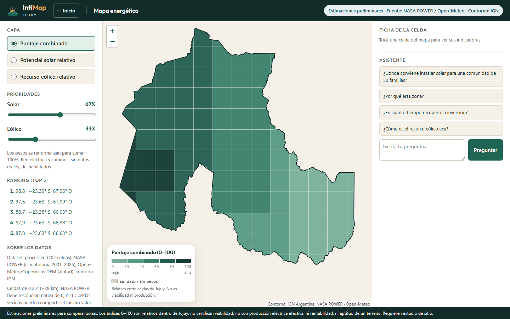
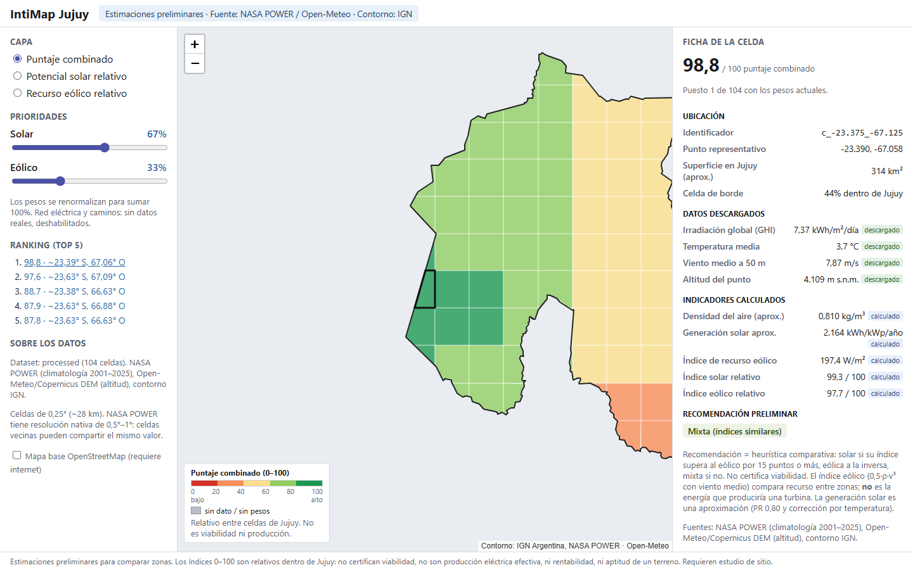
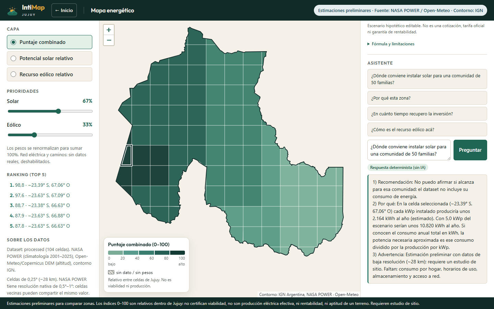

# IntiMap Jujuy

**Mapa interactivo para hacer un primer filtro del potencial solar y eólico en la provincia de Jujuy.**

IntiMap divide Jujuy en 104 zonas, muestra su recurso solar y eólico con datos climatológicos públicos, permite ajustar prioridades y, para cada zona, estima la generación solar, un escenario económico editable y una explicación en lenguaje simple.

> ⚠️ **Es una herramienta de evaluación preliminar.**
> - No es un estudio de factibilidad ni de ingeniería.
> - Los índices de 0 a 100 comparan zonas *dentro de Jujuy*; no certifican viabilidad, producción ni rentabilidad.
> - Toda decisión de inversión requiere mediciones y un estudio de sitio.

Proyecto desarrollado en el hackatón Tren Solar (Jujuy, 2026).

---

## Problema

Para decidir dónde conviene instalar energía renovable en Jujuy hay que cruzar datos dispersos y técnicos: irradiación, viento, altitud, temperatura. Ese primer filtro suele requerir consultores o herramientas globales que no hablan del territorio local.

Además, la provincia es muy heterogénea: Puna sobre los 3.500 m, quebradas y Yungas. Una misma velocidad de viento rinde distinto según la altitud, porque el aire es menos denso.

## Propuesta de valor

- **Un mapa de toda la provincia con datos reales y trazables.** Cada valor indica su fuente y si fue descargado o calculado.
- **Prioridades ajustables:** el ranking de zonas se recalcula al instante en el navegador.
- **Ficha por zona** con generación solar estimada y un **simulador económico transparente**: fórmulas visibles, supuestos editables y «No calculable» cuando faltan datos.
- **Asistente explicativo** que responde con los números del mapa y siempre termina con una advertencia. Funciona sin IA y sin internet.

## Público objetivo

- Municipios y comunidades rurales que buscan priorizar zonas para electrificación o autoconsumo.
- Instaladores y desarrolladores que necesitan un primer filtro antes de visitar un sitio.
- Productores e inversores que quieren comparar zonas de forma preliminar.

## Funcionalidades implementadas

| Funcionalidad | Detalle |
|---|---|
| **Mapa de Jujuy** | Contorno oficial del IGN y 104 celdas de 0,25° (~28 km) recortadas a la provincia, con tooltips y selección de celda. |
| **Tres capas** | Puntaje combinado, potencial solar relativo y recurso eólico relativo. Escala de 0 a 100 con leyenda. |
| **Prioridades** | Sliders solar y eólico, renormalizados a 100%. El ranking (top 5) y los colores se recalculan sin pedir nada al servidor. Con ambos en 0 aparece un aviso explícito. |
| **Ficha de la zona** | Muestra datos descargados (GHI, temperatura, viento a 50 m, altitud) e indicadores calculados (densidad del aire, kWh/kWp/año, índice eólico, índices relativos), con etiquetas de calidad. Incluye una recomendación preliminar solar, eólica o mixta. |
| **Simulador solar (USD)** | Parámetros editables: potencia, costo por kWp, valor de la energía, autoconsumo, mantenimiento y tarifa de inyección. Calcula generación, inversión, ahorro bruto y neto, y recuperación simple. |
| **Asistente** | Responde preguntas libres o sugeridas en 3 partes: recomendación, por qué y advertencia, con un máximo de 150 palabras. Es determinista por defecto; el LLM es opcional. |
| **Modo sintético** | Con `INTIMAP_DATASET=sample` usa 6 celdas de demostración, con un cartel rojo y etiquetas de «sintético». |

## Capturas

**Puntaje combinado (pesos por defecto: solar 67%, eólico 33%)**



**Ficha de la zona y simulador solar**



**Asistente (respuesta determinista)**



## Stack

- **Backend:** Python 3 + FastAPI + Uvicorn + Pydantic. Sirve la API y el frontend desde un solo proceso.
- **Frontend:** HTML, CSS y JavaScript sin framework. Usa [Leaflet 1.9.4](https://leafletjs.com) copiado en `frontend/vendor/`, sin CDN.
- **Datos:** archivos GeoJSON y JSON en `data/`, sin base de datos.
- **Pipeline de datos:** scripts Python con [Shapely](https://shapely.readthedocs.io).
- **LLM opcional:** SDK oficial `anthropic`. Solo se usa si existe `LLM_API_KEY`.

No hay autenticación, microservicios ni servicios pagos.

## Arquitectura

```
scripts/ (antes de la demo, con red)        app en ejecución (sin red)
  build_grid.py  ──► data/processed/  ──►  FastAPI (backend/app)  ──►  navegador (frontend/)
  fetch_data.py  ──► data/raw/ (caché)        /api/cells, /api/simulate,     mapa + sliders (scoring.js)
                                              /api/assistant, ...           ficha, simulador, asistente
```

Detalle completo y diagrama en [`docs/ARCHITECTURE.md`](docs/ARCHITECTURE.md).

## Instalación y ejecución

Requisitos: Python 3.11 o superior (probado con Python 3.13). El repositorio es privado por ahora, así que clonarlo requiere acceso.

```bash
git clone https://github.com/Esteban015/intimap-jujuy.git
cd intimap-jujuy
python -m venv .venv
# Windows: .venv\Scripts\activate    ·    Linux/Mac: source .venv/bin/activate
pip install -r backend/requirements.txt
python -m uvicorn backend.app.main:app --port 8000
```

Abrí http://localhost:8000. La documentación interactiva de la API está en http://localhost:8000/docs.

El dataset procesado ya viene en el repositorio, así que **no hace falta descargar nada para usar la app**. Para regenerar los datos, ver [`docs/SETUP.md`](docs/SETUP.md).

### Variables de entorno (opcionales)

| Variable | Uso |
|---|---|
| `INTIMAP_DATASET` | `auto` (por defecto), `processed` o `sample` (datos sintéticos). |
| `LLM_API_KEY` | Activa la redacción con IA del asistente. Sin ella, el asistente es determinista. |
| `LLM_MODEL` | Modelo del LLM opcional. Por defecto, `claude-opus-5-5`. |

Ver `.env.example`. Las claves se leen solo en el backend y nunca llegan al navegador.

## Fuentes de datos

| Dato | Fuente | Período / resolución | Condiciones de uso |
|---|---|---|---|
| Contorno provincial | [IGN Argentina](https://www.ign.gob.ar/NuestrasActividades/InformacionGeoespacial/CapasSIG), WFS `ign:provincia` (oficial) | Descargado el 2026-11-22 | Atribución al IGN. Los términos exactos están **a confirmar**. |
| Irradiación global horizontal, temperatura media a 2 m, viento a 50 m | [NASA POWER](https://power.larc.nasa.gov/docs/services/api/temporal/climatology/), Climatology API, comunidad RE | Climatología de 25 años (ene-2001 a dic-2025). Resolución nativa: solar ~1°, meteorología ~0,5°×0,625° | Datos públicos; citar según [las indicaciones de NASA POWER](https://power.larc.nasa.gov/docs/referencing/). |
| Altitud | [Open-Meteo Elevation API](https://open-meteo.com/en/docs/elevation-api) (Copernicus DEM GLO-90) | 90 m, un punto por celda | **Solo uso no comercial**, con atribución CC BY 4.0. |
| Mapa base (opcional, apagado por defecto) | OpenStreetMap | Teselas online | © OpenStreetMap. Requiere internet. |

Más detalle en [`data/SOURCES.md`](data/SOURCES.md) y [`docs/DATA_METHODOLOGY.md`](docs/DATA_METHODOLOGY.md).

## Cómo se calculan los indicadores (resumen)

| Indicador | Fórmula | Naturaleza |
|---|---|---|
| Generación solar específica | `GHI × 365 × 0,80 × (1 − 0,004 × (Tamb + 20 − 25))` en kWh/kWp/año | Estimado |
| Densidad del aire | `1,225 × (1 − 2,25577e-5 × altitud)^4,25588` en kg/m³ | Estimado |
| Índice de recurso eólico | `0,5 × ρ × v³` en W/m², con la velocidad **media** | Índice comparativo |
| Índices solar y eólico relativos | Normalización min-max de 0 a 100 entre las 104 celdas | Relativo a Jujuy |
| Puntaje combinado | `(w_solar × s_solar + w_eólico × s_eólico) / (w_solar + w_eólico)` | Relativo a Jujuy |
| Recomendación | «Solar» si s_solar ≥ s_eólico + 15; «Eólica» a la inversa; «Mixta» en otro caso | Heurística |
| Simulación económica | `generación = kWp × kWh/kWp`; `recuperación = inversión ÷ ahorro neto` | Escenario hipotético |

El índice eólico **no es la energía que produciría un aerogenerador**: no hay modelo de turbina ni distribución de vientos. Explicación completa en [`docs/DATA_METHODOLOGY.md`](docs/DATA_METHODOLOGY.md).

## Limitaciones

**Científicas**
- La grilla es de ~28 km, pero NASA POWER es más gruesa (0,5° a 1°): solo hay 12 valores distintos de irradiación en 104 celdas. Celdas vecinas pueden compartir valores.
- La altitud corresponde a un punto por celda. En quebradas varía mucho dentro de la misma celda.
- La generación solar usa irradiación sobre plano horizontal y temperatura media diaria. No modela inclinación, sombras ni suciedad.
- El índice eólico usa velocidad media, lo que subestima la densidad de potencia real, y no modela turbinas, rugosidad ni altura de buje.

**Económicas**
- La recuperación es simple: no es VAN, TIR ni rentabilidad garantizada.
- Omite degradación, baterías, inversores, conexión, permisos, financiamiento, inflación y variación de tarifas.
- Los valores por defecto (900 USD/kWp y 0,10 USD/kWh, del spec del proyecto) son un **escenario hipotético editable**, no cotizaciones ni tarifas oficiales.

**De alcance**
- No hay datos de red eléctrica, caminos ni localidades: esos factores no se ponderan.

## Modo offline y sin clave LLM

- **La app no llama a APIs externas mientras corre.** El backend solo lee archivos locales. Las únicas excepciones son el mapa base de OSM, opcional y apagado, y el LLM, solo si se configuró una clave.
- **Leaflet se sirve localmente:** las celdas y el contorno se ven sin internet.
- **Sin `LLM_API_KEY`, o si el LLM falla, tarda o se niega,** el asistente responde con plantillas deterministas calculadas a partir del dataset. La interfaz indica «Respuesta determinista (sin IA)».
- **El LLM, si se activa, solo reescribe la respuesta.** Si cambia o agrega números, se descarta.

## Validaciones realizadas

Durante el desarrollo se hicieron smoke tests en cada fase, con salida real. El registro está en [`docs/DECISIONS.md`](docs/DECISIONS.md) y en la descripción del PR #1:

- **Dataset:**
  - GeoJSON parseable y 104 geometrías válidas.
  - Ninguna celda fuera del contorno; la cobertura de la provincia es 1,000000.
  - Rangos físicos razonables.
  - Reconstrucción offline idéntica desde `data/raw/`.
- **Puntaje:** el puntaje de Python y el de JavaScript coinciden exactamente en 5 combinaciones de pesos.
- **Navegador (Chrome con Playwright):**
  - 104 celdas y contorno; las capas cambian la visualización.
  - Los sliders funcionan sin requests.
  - 0 errores de consola y 0 requests externos, en escritorio y móvil.
- **Simulador:** las cifras coinciden con la fórmula, por ejemplo 5 kWp × 2.164 kWh/kWp × 80% × 0,10 USD = 865,60 USD/año y 4.500 USD ÷ 865,60 = 5,2 años. Las entradas inválidas se rechazan.
- **Asistente:** sin clave, responde con valores del dataset y siempre con advertencia, sin kWh eólicos.

> El repositorio todavía **no incluye una suite de tests automatizados**. Ver [`docs/ROADMAP.md`](docs/ROADMAP.md).

## Próximas mejoras

Resumen; el detalle está en [`docs/ROADMAP.md`](docs/ROADMAP.md).
- Tests automatizados en el repositorio (puntaje, simulador, asistente).
- Localidades, red eléctrica y caminos como capas y factores de ponderación.
- Irradiación sobre plano inclinado y datos de mayor resolución.
- Una fuente de altitud apta para uso comercial.
- Comparación de zonas y exportación de la ficha.

## Documentación

| Documento | Contenido |
|---|---|
| [`docs/ARCHITECTURE.md`](docs/ARCHITECTURE.md) | Arquitectura, diagrama y flujo de consultas |
| [`docs/DATA_METHODOLOGY.md`](docs/DATA_METHODOLOGY.md) | Fuentes, fórmulas, supuestos y limitaciones |
| [`docs/DEMO_SCRIPT.md`](docs/DEMO_SCRIPT.md) | Guion de la presentación de 2 a 3 minutos |
| [`docs/ROADMAP.md`](docs/ROADMAP.md) | Lo implementado y lo propuesto |
| [`docs/SETUP.md`](docs/SETUP.md) | Instalación y regeneración de datos |
| [`docs/CONTRACTS.md`](docs/CONTRACTS.md) | Contratos de datos y API |
| [`docs/DECISIONS.md`](docs/DECISIONS.md) | Registro de decisiones técnicas |
| [`docs/PROJECT_SPEC.md`](docs/PROJECT_SPEC.md) | Especificación original del hackatón |
| [`docs/COLMENA_KIT.md`](docs/COLMENA_KIT.md) | Kit de orquestación usado para organizar el trabajo |

## Licencias de terceros

- **Leaflet:** BSD-2-Clause (`frontend/vendor/leaflet/LICENSE`).
- **Datos:** según cada fuente (ver la tabla de fuentes).

El código propio del proyecto todavía no declara una licencia.
