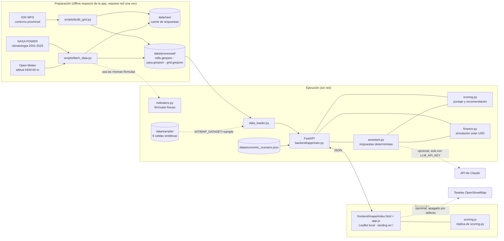
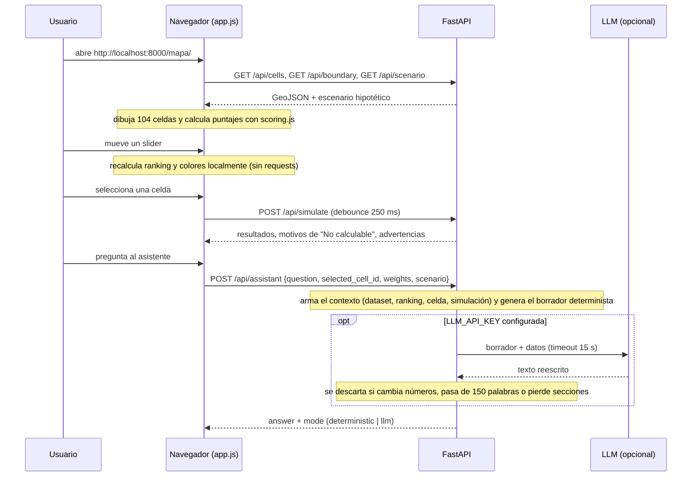

# Arquitectura — IntiMap Jujuy

Este documento describe la arquitectura **implementada** en la rama `feature/intimap-mvp`. Para las diferencias con el spec original, ver la sección final.

## Visión general

La aplicación es un único proceso FastAPI que sirve una API JSON y un frontend estático. Los datos se preparan **antes** de la demo con dos scripts y quedan en archivos locales. En ejecución, la app no consulta APIs externas: la única excepción es el LLM opcional.

## Componentes

### Procesamiento de datos (`scripts/`)
| Script | Entrada | Salida | Notas |
|---|---|---|---|
| `build_grid.py` | WFS del IGN (respaldo: geoBoundaries, marcado como NO oficial) | `data/processed/jujuy.geojson`, simplificado a ~200 m; `data/processed/grid.geojson` con 104 celdas recortadas | Grilla alineada a múltiplos de 0,25°. El id es el centro de la celda completa. `query_point` es un punto **dentro** de Jujuy. Si no hay contorno disponible, el script falla: no fabrica uno. |
| `fetch_data.py` | `grid.geojson`, NASA POWER (un punto por celda) y Open-Meteo (lotes de hasta 100 puntos) | `data/processed/cells.geojson` y la caché en `data/raw/` | Consultas secuenciales con pausa de 1 s, timeout de 60 s y 2 reintentos. Un fallo deja el campo en `null` con calidad `faltante`; nunca se completa con datos sintéticos. `--offline` reconstruye solo desde la caché. |

Los scripts requieren `scripts/requirements.txt` (Shapely). La app **no** los necesita para funcionar.

### Backend (`backend/app/`)
| Módulo | Responsabilidad |
|---|---|
| `main.py` | Rutas HTTP y montaje del frontend estático, que se monta al final para no tapar `/api`. |
| `data_loader.py` | Carga `data/processed/cells.geojson`, o la muestra sintética si no existe o si `INTIMAP_DATASET=sample`. Valida los campos mínimos. Marca la muestra como `synthetic` y le calcula índices desde GHI y viento. |
| `contracts.py` | Modelos Pydantic: `Weights` (al menos un peso mayor a 0), `Scenario`, `SimulateRequest` y `AssistantRequest`. |
| `indicators.py` | Fórmulas físicas puras: kWh/kWp/año, densidad del aire, índice eólico y normalización min-max. |
| `scoring.py` | Puntaje combinado, ranking y recomendación (heurística de 15 puntos). Es la **referencia matemática** del puntaje. |
| `finance.py` | Simulación solar en USD. Es la **única** implementación del cálculo económico. |
| `assistant.py` | Detecta la intención por palabras clave, arma el contexto y genera respuestas deterministas. El LLM es opcional y su salida se valida. |

### Frontend (`frontend/`)
| Archivo | Responsabilidad |
|---|---|
| `index.html` + `landing.css` + `assets/` | Landing comercial en `/`: HTML y CSS con tokens de `assets/brand.css`, sin Leaflet ni datos. |
| `mapa/index.html` / `styles.css` | Herramienta en `/mapa/`. Tres paneles: capas y prioridades, mapa, y ficha con simulador y asistente. En pantallas angostas pasa a una sola columna. |
| `app.js` | Carga datos, dibuja celdas y contorno, maneja capas y sliders, y muestra ficha, simulador y asistente. Maneja estados de carga y error. |
| `scoring.js` | Réplica exacta de `scoring.py`, para que los sliders recalculen sin requests. Usa el mismo redondeo half-up, el mismo tratamiento de nulos y el mismo desempate. |
| `vendor/leaflet/` | Leaflet 1.9.4 local, con licencia BSD-2. |
| `assets/` | Sistema visual compartido (`brand.css`, con tokens `--im-*`), logo y favicon SVG, fuente Outfit autoalojada (OFL), sprite de íconos Lucide (ISC), capturas de la landing y `landing.js` (menú móvil). Todo local, sin CDN. |

### Almacenamiento local
Todo son archivos versionados en `data/`; no hay base de datos.
- `processed/cells.geojson`: dataset que consume la app.
- `processed/jujuy.geojson`: contorno simplificado.
- `processed/grid.geojson`: grilla sin datos climáticos, que usa el pipeline.
- `raw/`: respuestas originales de las APIs, que permiten reconstruir todo sin red.
- `sample/cells.sample.geojson`: 6 celdas sintéticas de respaldo.
- `economic_scenario.json`: valores por defecto del simulador, rotulados como escenario hipotético.
- `assumptions.json`: **histórico, no lo usa ningún componente** (ver `DATA_METHODOLOGY.md`, §8).

## API

| Método | Ruta | Uso |
|---|---|---|
| GET | `/api/health` | Estado: dataset entregado, `synthetic`, conteos, período climático, si hay contorno y si el LLM está configurado. |
| GET | `/api/cells` | FeatureCollection completo. Incluye el header `X-IntiMap-Dataset: processed` o `sample`. |
| GET | `/api/cells/{id}` | Una celda; 404 si no existe. |
| GET | `/api/boundary` | Contorno de Jujuy. |
| POST | `/api/scores` | Ranking calculado con `scoring.py`. Sirve para verificar; la UI no lo usa. |
| GET | `/api/scenario` | Escenario económico hipotético por defecto. |
| POST | `/api/simulate` | Simulación solar de una celda. |
| POST | `/api/assistant` | Respuesta del asistente. |

Los contratos completos están en [`CONTRACTS.md`](CONTRACTS.md). La documentación interactiva queda en `/docs` (Swagger de FastAPI) con el servidor corriendo.

## Flujo de consultas

## Decisiones de diseño relevantes
- **Un solo proceso, sin base de datos:** el volumen es de unos 100 polígonos y el objetivo era una demo robusta en una jornada.
- **Puntaje en el cliente y finanzas en el servidor.** El puntaje necesita respuesta instantánea con los sliders, así que se replica en JS y su equivalencia está verificada. El cálculo económico tiene una sola implementación en Python, compartida con el asistente.
- **El asistente es determinista primero:** los cálculos nunca dependen del LLM.
- **La procedencia viaja con el dato:** cada campo tiene calidad (`real`, `estimado`, `faltante` o `sintetico`) y metadatos de fuente y fecha.

El registro completo está en [`DECISIONS.md`](DECISIONS.md).

## Diferencias con el spec original (`PROJECT_SPEC.md`)
| Spec | Implementado | Motivo |
|---|---|---|
| Next.js + TypeScript + Tailwind + react-leaflet | HTML, CSS y JS sin framework + Leaflet local | Indicación del equipo de mantener FastAPI + frontend estático; menos dependencias. |
| `data/cells.geojson`, `data/jujuy.geojson`, `cells_raw.json` | `data/processed/`, más la caché en `data/raw/` | Instrucción de la Fase 1 (DECISIONS 14). |
| `make_synthetic.py` | 6 celdas en `data/sample/` | Los fallos de API no se rellenan con valores sintéticos (DECISIONS 22). |
| `GET /api/towns` y `towns.json` | No implementado | Pendiente; ver `ROADMAP.md`. |
| Pesos de red y acceso | Deshabilitados | No hay datos reales (DECISIONS 26). |
| Viento a 50 o 100 m | 50 m (WS50M) | Sin extrapolar (DECISIONS 21). |
| Escala de color rojo-amarillo-verde | Escalas secuenciales de un tono por capa: verde (combinado), dorado (solar), azul pizarra (eólico) | La escala divergente fallaba la validación de paletas; los cortes de clase no cambiaron (DECISIONS 43 y 53). |
| Una sola página | Landing en `/` y herramienta en `/mapa/` | Fase 6 (DECISIONS 44 y 48). |
| Economía con tarifa × kWh | Agrega autoconsumo, mantenimiento, excedentes y «No calculable» | Pedido de la Fase 3 (DECISIONS 31-33). |
